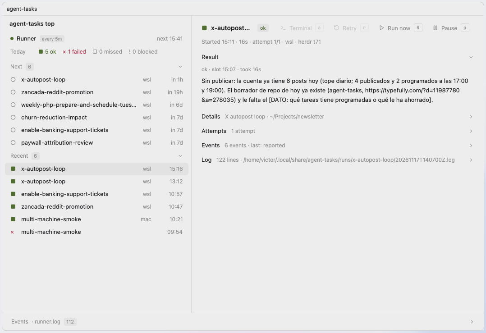

# Agent tasks

A Herdr view of [`agent-tasks top`](https://github.com/victor-falcon/agent-tasks),
the dashboard of the agent-tasks scheduler: a small foldable panel in the
sidebar with the runner, today's results and the Running / Next / Recent runs,
and a dashboard pane with the selected run's result, output, details,
attempts, events and log, and buttons to retry it, run its task now or pause
it. Folded, the panel is one line, `Agent tasks`, with a red dot when
something needs you.



## Requirements

The mod is only a view: everything it shows and does comes from the
agent-tasks CLI, which has to be set up first.

- **The [agent-tasks](https://github.com/victor-falcon/agent-tasks) CLI,
  installed** on the machine Herdr reaches, and on that machine's login PATH
  (Herdr starts programs with your login environment). Run
  `bin/agent-tasks install` in its checkout to link it into your bin folder.
- **A recent version**, one that has `agent-tasks top`. The mod reads
  `top --json`, plus `log`, `show` and `version`. `data_dir` in
  `top --json` (agent-tasks #23) lets it watch the right data folder; older
  CLIs fall back to `~/.local/share/agent-tasks`.
- **At least one task configured** (ask an agent to schedule one, or
  `agent-tasks add`), and **a runner running** (`agent-tasks runner`, in a
  terminal that stays open). Without a runner, nothing starts: the panel
  says so and offers a button that runs it in a new tab.
- **Which machine.** `props.machine` (a Herdr machine name) wins when set.
  Otherwise the mod uses this computer if `agent-tasks version` works there,
  else the first ready machine (`machines()`) where it does, and remembers
  the choice. Found nowhere, it shows the CLI-not-found state.

## What you see

### The sidebar panel (a layout block, about 280px wide)

- **Header** (26px, text 11.5px `dim`, 8px rounded hover in `hover`):
  `Agent tasks` on the left, a chevron on the right (`chevron-down` open,
  `chevron-right` folded). Clicking anywhere on it folds or unfolds the panel.
  A 7px `ansi1` (red) dot sits left of the chevron when something needs
  attention (the runner isn't healthy, or a run failed, was missed or is
  blocked today): when folded, and always while the runner is stopped. A dim
  `!` says the last refresh failed (hover it for why).
- **Runner** (22px): a 7px dot (`ansi2` healthy, `ansi1` stopped), `Runner`
  (12px `foreground`), a badge (10px `dim` on `hover`, radius 4) with
  `every 5m` or `stopped`, and on the right (10.5px `dim`) `next 11:12`, or in
  red how long ago the last tick was. Hover: the last tick's time.
- **Stopped runner:** `Nothing starts until it's back. N slots past due.` and
  a `Start runner in a new tab` button, which opens a Herdr tab running
  `agent-tasks runner`.
- **Today** (20px, 11px): `Today` in `dim` (44px), then `■ 3` (`ansi2`),
  `× 1` (`ansi1`), `□ 0`, `! 0` (`ansi3` when above 0); zeros are `dim`.
- **Running / Next / Recent:** each a 22px line (12px name, a count badge, a
  small chevron) that folds its rows (shared, `agent-tasks.groups`). Up to 5
  rows each, 20px, 11px: the status glyph (`◐` running in `ansi4`, `○` next,
  `‖` paused, `■` ok in `ansi2`, `×` failed in `ansi1`, `!` blocked in `ansi3`,
  `□` missed), the task id, and on the right (10.5px `dim`) the elapsed time
  for a run in progress (`ansi4`), `in 23h` / `paused` for the next ones, the
  time (`HH:MM`, else the weekday or the date) for recent ones. Hovering a
  recent row shows its summary. Clicking a run opens the dashboard on it. A
  group with more rows ends in `+N more in the dashboard`.
- **Open dashboard** (11px `dim`, a panel icon): opens the dashboard pane
  beside the focused pane, or focuses it if this tab has one.

### The dashboard pane (`agent-tasks top`)

Roomier than the sidebar block: it is for clicking around. Hover and the
selection cover the whole row, with rounded corners (radius 6).

- **Left (420px, a `border` line on its right):** the runner line (30px,
  13px), today's counts spelled out (28px, 12px: `3 ok`, `1 failed`,
  `0 missed`, `0 blocked`), then the foldable Running / Next / Recent groups
  (30px `dim` headers, 12px, with a count badge and a chevron). Rows are
  28px with 12px side padding: the task id at 13px, then the machine and a
  60px right column at 12px `dim`. The selected row has a `hover` background.
- **Right: the selected run.** Its glyph, the task id (14px semibold), a
  status badge (11px, the status color on `hover`), and ghost buttons
  (30px, 12.5px `dim`, icon, label and key): **Terminal** (`a`), **Retry**
  (`r`), **Run now** (`R`), **Pause** / **Resume** (`p`). Below, 12px `dim`:
  `Started 10:57 · 11m · attempt 2/2 · wsl · herdr t38`.
- **Bottom, across both columns: `Events · runner.log`.** A 30px header
  (name, count badge, chevron) folds it. The fold is shared in
  `agent-tasks.paneGroups`. Open, it takes 30% of the pane's height and
  scrolls: the newest line first, 12px, with the time, the glyph and the
  whole text, which wraps instead of being cut. Folded, only the header
  shows and the columns get the room.
- Then foldable sections (30px headers: the name at 13px in `foreground` 500,
  what is inside at 12px in `dim`, a chevron), the same as `agent-tasks top`'s run view:
  **Result** (status, slot, how long, and the agent's summary) and **Output**
  (the file passed to `finish --output-file`) open when there is a result;
  **Details**, **Attempts**, **Events** folded; **Log** (the last 400 lines)
  open when there is no result. Result and Output are sans 13px; the others
  mono 11.5px on a `raised` background, radius 6.
- Selecting a task in Next shows the task (title, schedule, next run,
  machine) with Run now and Pause.
- **Retry** and **Run now** start an agent, so the first press turns the
  button into `Confirm retry` / `Confirm run now` (`ansi3`) for 4 seconds
  and the second one runs it. A disabled button says why on hover.
- An action shows a strip at the bottom with the command it ran and `done`,
  or the error in `ansi1`.
- Keys, once the pane has the keyboard (click it): `j`/`k` (or the arrows)
  move, `g`/`G` first/last, `a` `r` `R` `p` the actions.

### States

- **Runner stopped:** the red dot and the message and button above.
- **No tasks yet:** `Nothing scheduled yet. Ask an agent:` and an example.
- **CLI not found** (`agent-tasks` isn't on the login PATH): `agent-tasks
  isn't on your login PATH`, a link to the repository (`Get it:
  github.com/victor-falcon/agent-tasks`, which opens it), `In its checkout:
  bin/agent-tasks install`, and a dim `!` in the header.
- **Refresh failed:** a dim `!` in the header (hover: the error), a one-line
  `ansi3` message, and the last good data at 55% opacity.
- **Unknown schema** (a newer agent-tasks): the same banner, asking to update
  the mod.
- **Unreadable files** (`errors` in `top --json`): `N files couldn't be read`,
  with the CLI's messages on hover.

Only theme colors (`foreground`, `dim`, `hover`, `border`, `raised`, `ansi1`
to `ansi4`), so light and dark themes both work.

## How it behaves

- One call reads everything: `agent-tasks top --json`. The snapshot is shared
  (`agent-tasks.snapshot`, with `agent-tasks.fetchedAt`), so the panel and the
  pane don't each run it.
- It is read again when something changes in the data folder (`watchFolder`
  on the `data_dir` that `top --json` reports; older CLIs don't, so the folder
  the runner's start line in `runner.log` names, else
  `~/.local/share/agent-tasks`), after 0.7 s of quiet and at most every 1.5 s
  (appends to a run's captured log are ignored), every
  minute (relative times and the runner's health move on their own), and
  after an action. The folder is watched only if it exists on this computer:
  with `machine` set, or on a client machine where `top` runs on the hub
  over SSH (so `data_dir` is the hub's path), only the minute timer reads.
- The selected run is read with `agent-tasks log <ref> --json` (events,
  attempts, the captured log) and `agent-tasks show <task> --json` (title,
  folder, retries), again when it changes, and every minute while it runs.
  The only file read directly is the run's output file, at the path the CLI
  gives (relative ones are under its data folder).
- Actions are the CLI's own commands: `agent-tasks retry <ref>` (failed,
  timed-out and missed runs), `agent-tasks run <task>`, `agent-tasks
  pause|resume <task>`. **Terminal**, for a run whose session is still open:
  when the herdr launcher started it and its terminal is alive, focuses its
  pane (or peeks at it if it has none); else opens a tab running `agent-tasks
  attach <ref>`.
- The folded state (`agent-tasks.folded`) and the groups' (`agent-tasks.groups`,
  `agent-tasks.paneGroups`) are shared and survive restarts.
- With `props.block` set, the block resizes itself to the panel's height
  (`layout.resize`), so folding gives the room back to the blocks above.
- Command **`agent-tasks.toggle`** opens the dashboard in the focused tab, or
  closes it if that tab has one. No key is bound: add a palette entry or bind
  `agent-tasks.toggle` in `keys.json` (`"cmd-shift-t": "agent-tasks.toggle"`)
  if you want one. The sidebar block handles it, so it needs the block in the
  shown layout.
- The block is optional. The pane works on its own: a palette entry can open
  it with `run("pane.split", { direction: "right", pane: <focused pane>,
  mod: "agent-tasks", props: { view: "dashboard" } })`. It reads the CLI
  itself and opens on the first run in progress, else the latest result.
- **Where agent-tasks runs.** `props.machine` wins when set. Otherwise the mod
  looks once, the first time it reads: this computer if `agent-tasks version`
  works here, else the first ready machine (`machines()`) where it does.
  The choice is kept in `agent-tasks.machine`, shared by every copy, so the
  block and the pane agree. If that machine later says the CLI is missing,
  or can't be reached, the mod looks again on its next read. Found nowhere:
  the CLI-not-found state, and it looks again a minute later.

## Built from

- One mod, `mods/agent-tasks/`:
  - `panel.js`: everything (reading the CLI, the sidebar panel, the dashboard
    pane, the actions), with no Herdr state of its own beyond shared keys.
  - `main.js`: draws the panel as a layout block (keeping the block's height
    in step, and handling `agent-tasks.toggle`) or, with `view: "dashboard"`,
    the pane.
  - `chevron-right.svg`, `chevron-down.svg`, `panel-right.svg`,
    `terminal.svg`, `rotate-ccw.svg`, `play.svg`, `pause.svg` (Lucide).
- `top --json` gives `runner` (`state`: healthy, stale or never; `every`,
  `last_tick`, `next_tick`), `running`, `next`, `recent` (each run with `ref`,
  `task_id`, `status`, `attempt`, `started_at`, `at`, `summary`, `handle`,
  `machine`), `today`, `events` (the end of `runner.log`), `errors`, `schema`
  and, in newer versions, `data_dir`.
- The layout: a block in a column, under whatever fills the rest of it:

  ```json
  { "id": "agent-tasks", "type": "block", "size": { "px": 32 },
    "content": { "mod": "agent-tasks", "props": {
      "block": "agent-tasks" } } }
  ```

  `block` must be the block's own `id`. Add `"machine": "<name>"` (the
  Herdr machine, a space's `machine`) only to pin where agent-tasks runs;
  left out, it is found as above. The pane it opens gets
  `{ "view": "dashboard", "run": "<ref>" }`, plus `machine` when pinned.

## What it runs and reads

- Runs your `agent-tasks` CLI (on the chosen machine through herdr-core):
  `version` while looking for it (here, then on each ready machine), `top
  --json` on changes and every minute, `log` and `show` for the run you look
  at, and the action you click. It also runs `test -d` to check that the
  data folder exists here before watching it. Nothing else, and no network
  requests of its own.
- Reads a run's output file, at the path the CLI gives.

## Watch out

- Herdr starts programs with your login environment: `agent-tasks` must be on
  that PATH (`bin/agent-tasks install` in its checkout links it there).
- Retry, Run now and Start runner launch agents and terminals right away, the
  same as typing the command.
- Folders on another machine can't be watched: there it reads once a minute
  (and after each action), so a change can take up to a minute to show.
- A block's height is fixed in the layout; that's why the mod resizes its own
  block, and why it needs its id in `props.block`.
- Asset paths are `mods/agent-tasks/...`: install the folder under that name,
  by copying (a symlink out of Herdr's home draws blank icons).

## Done when

- `herdr-app check ~/.config/herdr-app/mods/agent-tasks` passes.
- The panel shows the same runner state, counts and runs as
  `agent-tasks top`.
- Clicking the header folds it and the block shrinks to the header; a failed
  run today, or a stopped runner, shows the red dot.
- Clicking a run opens the dashboard on it; Retry on a failed run starts a
  new attempt and the strip says `done`.
- Running `agent-tasks.toggle` twice opens and closes the dashboard.
- With no `machine` prop and agent-tasks only on another connected machine,
  the panel finds it and shows its data.
- `pane.split` with `{ mod: "agent-tasks", props: { view: "dashboard" } }`
  and no block in the layout opens a working dashboard.
