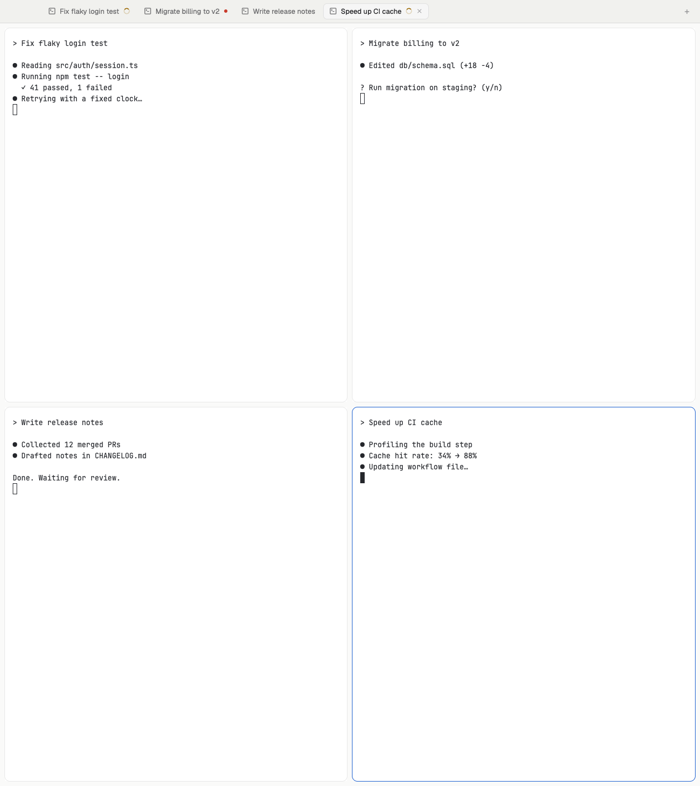

# Agent wall

One key turns every agent in the current space into a wall of panes, so you
can watch them all at once, whichever tab each one lives in. Press it again
and the window goes back to exactly how it was. `ctrl-h/j/k/l` move between
the agents on the wall and keep moving between panes everywhere else.



## What you see

- **Wall off:** your layout, unchanged.
- **Wall on:** the layout's `main` block (the shown tab) is replaced by a grid
  of live terminals, one per agent of the focused space, from every tab, in
  space → tab → pane order. Everything around it (sidebar, tab bar, side
  panels) stays where it was.
- The grid has at most 3 agents per row. Up to 3 agents share one row; more
  are split into `ceil(n / 3)` rows as evenly as possible, wider rows last:

  | Agents | Rows      |
  |--------|-----------|
  | 1–3    | 1, 2, 3   |
  | 4      | 2 + 2     |
  | 5      | 2 + 3     |
  | 6      | 3 + 3     |
  | 7      | 2 + 2 + 3 |
  | 8      | 2 + 3 + 3 |
  | 9      | 3 + 3 + 3 |

- Each cell copies the look of the tab block's pane frame (`main.content.pane`):
  its `background`, `border`, `focus` border, `radius` and `gap`, falling back
  to `background`, a 1px `border`, a 1px `accent` focus border, radius 10 and
  gap 8. Cells have no pane header.

## How it behaves

- `cmd-ctrl-shift-a` toggles the wall.
  - On: focus goes to the agent you were on (`agents()[i].focused`), else the
    first one. With no agents in the space it shows an info toast and does
    nothing.
  - Off: the original `main` block comes back and focus goes to the pane of
    the agent you had focused on the wall, else the pane focused before the
    wall opened.
- `ctrl-h` / `ctrl-l` move left / right along a row and stop at its ends.
  `ctrl-k` / `ctrl-j` move to the row above / below, to the cell whose
  horizontal center overlaps the current one most (with 2 + 3, `ctrl-j` from
  the second agent lands on the fifth).
- Outside the wall, or when focus is not on a wall cell, the same keys run
  `pane.go` exactly as before.
- The wall shows the agents that existed when it opened; toggle it off and on
  to pick up new ones. Agent status changes show in the tab bar and sidebar
  as usual.
- The original block is kept in shared state (`agent-wall.saved`), so a wall
  left on survives a restart and can still be toggled off.

## Built from

- One mod, `mods/agent-wall/` (`main.js`, `mod.json` with `"place": "none"`
  and a 1×1 popup overlay). It runs in two roles:
  - **Navigator** (`props: { nav: true }`): a copy docked in the layout that
    loops on `nextCommand()` and handles `toggle`, `left`, `right`, `up`,
    `down`. This is the copy the keys reach.
  - **Launcher**: `mod.open:agent-wall` opens it as an invisible popup that
    toggles once and closes itself. Works without the navigator, but then
    there is no wall navigation.
- **The layout change.** Add the navigator next to your tab bar as a 0px
  block, so a copy of the mod is always shown. Wrap the tab bar block in a row
  that takes over its `size` and `window_drag`:

  ```json
  {
    "id": "tabs-row",
    "type": "row",
    "size": { "px": 42 },
    "window_drag": true,
    "resizable": false,
    "children": [
      { "id": "tabs", "type": "block", "content": { "mod": "auto-tabs" } },
      {
        "id": "agent-wall-nav",
        "type": "block",
        "size": { "px": 0 },
        "content": { "mod": "agent-wall", "props": { "nav": true } }
      }
    ]
  }
  ```

  Keep your own tab bar's `content` and size. Any always-shown place works
  (not the sidebar if you hide it, nor a hidden node: key commands only reach
  shown copies). Don't put it in a row with a `gap`, or the gap shows.
- Toggling on: reads `layout()`, saves the node with id `main` and the focused
  pane in `setShared("agent-wall.saved", …)`, and calls `layout.set` with a
  copy of the tree where `main` is a `column` (id `agent-wall`) of `row`s of
  `{ "terminal": "<address>" }` blocks. Toggling off swaps the `agent-wall`
  node back for the saved one. Focus moves with
  `pane.focus { terminal }` / `pane.focus { pane }`.
- Navigation reads the grid back from `layout()` and the current cell from
  `focused().terminal`.
- `herdr` functions: `agents`, `focused`, `layout`, `panes`, `run`, `shared`,
  `setShared`, `nextCommand`, `notify`, `props`, `closeOverlay`. Commands:
  `layout.set`, `pane.focus`, `pane.go`. No programs, no network, no files.
- `keys.json` binds `cmd-ctrl-shift-a` → `agent-wall.toggle` and
  `ctrl-h/l/j/k` → `agent-wall.left/right/down/up`.

## Watch out

- **Needs a personal layout.** `layout.set` refuses structural changes to
  Herdr's shipped layouts. On `main`, clone it first
  (`herdr-app do layout.clone '{"name":"main","as":"my-main"}'`) and add the
  navigator block to the clone.
- **Needs a block with id `main`** showing `{ "tab": "active" }`, as Herdr's
  `main` layout and its clones have. Otherwise toggling shows an error toast.
- **Why `ctrl-hjkl` go through the mod:** `pane.go` doesn't move between
  layout terminal blocks, only between a tab's panes. Keys can't be
  conditional, so the navigator does it: grid moves on the wall, `pane.go`
  elsewhere. Without the navigator block those keys do nothing at all
  (`<mod>.<command>` only reaches shown copies), so add the block before
  binding them.
- **Don't edit the layout file while the wall is on.** Toggling uses the
  layout as it was when you pressed the key; a toggle racing a hand edit can
  write back a tree without your edit.
- `layout.set` writes the layout file, including sizes you only dragged
  (stored under `layouts/.state/`). They look the same, but the file changes.
- `ctrl-h/j/k/l` are taken from terminal programs (`ctrl-k` and `ctrl-l` are
  readline shortcuts). Pick other keys if you use those.

## Done when

- `herdr-app check ~/.config/herdr-app/mods/agent-wall` passes.
- In a space with 4 agents in different tabs, `cmd-ctrl-shift-a` shows them
  2 + 2; with 3 agents, one row of 3; with 5, 2 on top and 3 below.
- On the wall, `ctrl-h/l` move along a row and stop at the ends, and
  `ctrl-j/k` change rows (`herdr-app status` shows `focused_pane` as
  `agent-wall-<address>`).
- Pressing `cmd-ctrl-shift-a` again restores the layout: the `agent-wall`
  node is gone from the layout file and the tab shows again, focused on the
  agent you were on.
- In a tab split in two, `ctrl-h/l` still move between its panes.
