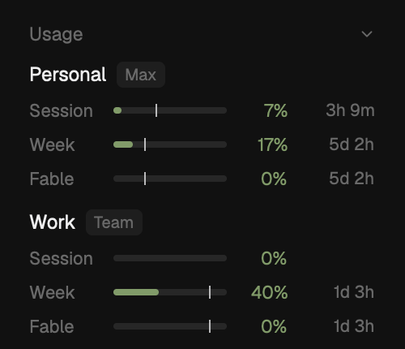

# Claude usage

A small foldable panel with the subscription limits of one or more Claude
accounts (say, Personal and Work): the 5-hour session, the weekly limit and
any per-model weekly limit, each with a bar, a pace tick, the percent used and
the time to reset. Folded, it is one line, `Usage`, with a red dot when any
limit of any account reaches 75%.



## What you see

- **Header** (26px, text 11.5px `dim`, 8px rounded hover in `hover`): `Usage`
  on the left, a chevron on the right (`chevron-down` open, `chevron-right`
  folded). Clicking anywhere on it folds or unfolds the panel.
- **Folded:** only the header. When any limit is at the warning level (75% by
  default), a 7px round dot in `ansi1` (red) sits just left of the chevron,
  the same shape agent lists use for an agent that needs you.
- **Open:** one group per account, 6px apart:
  - a 22px line: the account's name (12px `foreground`) and its plan as a
    small badge (10px `dim` on `hover`, radius 4: `Max`, `Team`, `Pro`).
    Hovering it says when it was last read, or why it failed. A failing
    account shows a dim `!` on the right and keeps its last reading at 55%
    opacity; before the first reading it shows `…`.
  - one 20px line per limit (text 11px): its name in `dim` (44px wide:
    `Session`, `Week`, or the model, e.g. `Fable`), a 4px bar (track
    `border`, fill = percent used), a 1×8px `foreground` tick at 75% opacity
    for how much of the window's time has passed, the percent (30px, right
    aligned) and the time to reset (46px, 10.5px `dim`: `3h 9m`, `5d 2h`).
    Hovering a line says `Resets in …`.
- Colors by percent: under the warning level `ansi2` (green), from it `ansi3`
  (amber), 90% and up `ansi1` (red). A limit whose reset time has passed shows
  `—` until the next reading.

## How it behaves

- Not tied to agent status (working, blocked, done, idle): limits belong to
  accounts, not agents.
- Reads every account at start and every 5 minutes, one after the other.
  An account added to the props is read at once. Countdowns redraw every minute.
- Readings older than 15 minutes are dimmed.
- The folded state is shared (`claude-usage.folded`) and survives restarts.
- With `props.block` set, the block resizes itself to the panel's height
  (`layout.resize`), so folding gives the room back to the blocks above.

## Built from

- One mod, `mods/claude-usage/`:
  - `panel.js`: everything (fetching, parsing, drawing), with no Herdr state
    of its own beyond shared keys, so another mod can carry a verbatim copy and
    draw the panel inside its own layout. Herdr won't import across mod
    folders.
  - `main.js`: draws `panel.js` as a layout block and keeps the block's height
    in step.
  - `claude-usage.sh <config dir | ->`: runs `claude -p --safe-mode
    --no-session-persistence --input-format stream-json --output-format
    stream-json --verbose` with that `CLAUDE_CONFIG_DIR` (`-`: the default
    `~/.claude`), sends `{"type":"control_request",…,"request":{"subtype":
    "get_usage","skip_behaviors":true}}`, prints the `control_response` line
    and kills the CLI. Exits 0 with the line, 127 without a `claude` CLI, 1
    with no reply in 15 s.
  - `chevron-right.svg`, `chevron-down.svg` (Lucide).
- The reply's `rate_limits.limits[]` gives `kind` (`session`, `weekly_all`,
  `weekly_scoped` + `scope.model.display_name`), `percent` and `resets_at`;
  older CLIs only have `five_hour` / `seven_day.utilization`, also read.
- Shared state: `claude-usage.state` (readings per account),
  `claude-usage.folded`, `claude-usage.fetchedAt` (so copies share one fetch).
- The layout: a block in a column, under whatever fills the rest of it:

  ```json
  { "id": "claude-usage", "type": "block", "size": { "px": 32 },
    "content": { "mod": "claude-usage", "props": {
      "block": "claude-usage",
      "accounts": [
        { "name": "Personal", "config": "~/.claude-personal" },
        { "name": "Work" } ],
      "warn": 75,
      "lang": "en" } } }
  ```

  `block` must be the block's own `id`. Each account's `config` is its
  `CLAUDE_CONFIG_DIR`; leave it out for the default `~/.claude`. With no
  `accounts`, one account named `Claude`. `lang`: `en` (default) or `es`.

## What it runs and reads

- Runs `sh` and your `claude` CLI, briefly, once per account every 5 minutes.
  The CLI signs in with that account's own login and talks to Anthropic; the
  mod makes no network requests itself.
- Reads no token or credential file, sends no prompt and starts no turn: no
  model usage.

## Watch out

- `get_usage` is an internal Claude Code interface (verified on 2.1.319). If
  an update changes it, the account shows `!` with the reason.
- An `ANTHROPIC_API_KEY` in the environment makes the CLI use the API key and
  report no limits: the helper unsets it, with `CLAUDECODE`.
- Herdr starts programs with your login environment: `claude` must be on that
  PATH (the helper also tries `~/.local/bin/claude`).
- Resets land a fraction of a second before the minute (`13:59:59.6`): they are
  rounded to the minute.
- A block's height is fixed in the layout; that's why the mod resizes its own
  block, and why it needs its id in `props.block`.
- Asset and helper paths are `mods/claude-usage/...`: install the folder under
  that name, by copying (a symlink out of Herdr's home draws blank icons).
- macOS and Linux only (`sh`, `mkfifo`). Local machine only.

## Done when

- `herdr-app check ~/.config/herdr-app/mods/claude-usage` passes.
- `sh mods/claude-usage/claude-usage.sh -` prints a `control_response` line in
  about a second and leaves no `claude` process behind.
- The panel shows the same numbers as Claude Code's `/usage` for each account.
- Clicking the header folds it, the block shrinks to the header, and a limit at
  75% or more shows the red dot.
