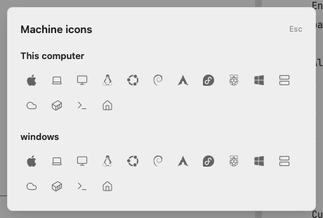

# Machine icons

Pick the icon each machine shows in the sidebar: an Apple for this Mac, Tux for
a WSL or Linux box, the Windows logo, a server, a cloud...



## What you see

A "Machine icons" dialog with one section per machine ("This computer" first,
then every machine from `hc machine ls`), each with a grid of icons. Click one
to use it, click it again (or "Default") to go back to the sidebar's own icon.
The sidebar changes as you click.

Icons: Apple, Laptop, Desktop, Linux, Ubuntu, Debian, Arch, Fedora,
Raspberry Pi, Windows, Server, Cloud, Container, Terminal, Home.

## How it behaves

- Open it with `mod.open:machine-icons` (a key, a palette entry or a click in
  your sidebar). With props `{ machine: "<name>" }` it shows only that machine;
  `""` is this computer.
- The choice is kept in `shared("machine-icons")`:
  `{ "": "apple", "windows": "linux" }`. Keys are machine names, `""` for this
  computer; values are icon names in `mods/machine-icons/icons/`.
- It only stores the choice. Herdr's own sidebars are read-only, so the mod
  that draws your machines has to read it (see below).

## Showing the icons in your sidebar

Herdr won't import across mods. Copy `mods/machine-icons/machine-icon.js` next
to your sidebar mod's `main.js`, then replace its hard-coded machine icon:

```js
import { machineIcon } from "./machine-icon.js";

// was: svg(`mods/workspace-chrome/${m ? "server" : "monitor"}.svg`)
svg(machineIcon(m, `mods/workspace-chrome/${m ? "server" : "monitor"}.svg`))
```

`machineIcon(machine, fallback)` takes a space's `machine` (null for this
computer) and returns the picked icon's path, or `fallback`. To edit a
shipped sidebar (`spaces`, `workspace-chrome`), clone it first:
`herdr-app do mod.clone '{"name":"spaces","as":"my-spaces"}'`.

A nice touch: open the dialog for one machine when its icon is clicked.

```js
.on_mouse_down("left", (_e, cx) => {
  cx.stop_propagation();
  openOverlay({ mod: "machine-icons", kind: "dialog", width: 440, props: { machine: m ?? "" } });
})
```

## Built from

- One mod, `mods/machine-icons/`: `main.js` (the dialog), `machine-icon.js`
  (the helper other mods copy), `mod.json` (`"place": "none"`, a 440px
  dialog overlay) and `icons/*.svg`.
- `herdr` functions: `machines`, `shared`, `setShared`, `theme`, `props`,
  `closeOverlay`. No commands, no programs, no network, no files.
- Icons: logos from [Simple Icons](https://simpleicons.org) (CC0; the logos
  are their owners' trademarks), outlines from [Lucide](https://lucide.dev)
  (ISC) redrawn at a 1.5 stroke to match Herdr's sidebar. Windows is a plain
  four-pane shape. All are tinted with the text color.
- No keys: bind `mod.open:machine-icons` in `keys.json` or add it to your
  command palette if you want one.

## Watch out

- An icon is kept by machine name. Rename a machine (`hc machine`) and pick
  its icon again.
- Machines added with `--temp` aren't listed: Herdr leaves them out of
  `machines()`.

## Done when

- `herdr-app check ~/.config/herdr-app/mods/machine-icons` passes.
- `herdr-app do mod.open '{"name":"machine-icons"}'` lists this computer and
  each machine.
- Picking Apple for "This computer" turns its icon in your sidebar into an
  apple at once; "Default" turns it back.
