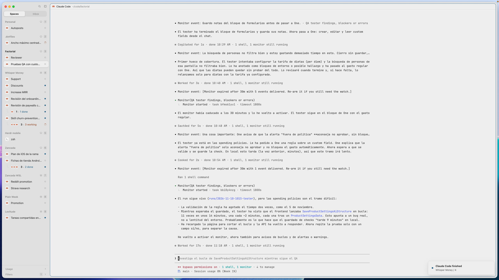

# Reading width

An agent alone on a big screen draws its lines across the whole window, which
is hard to read. With this mod, when an agent is the only pane on screen, its
text stops at about 120 columns and sits centered in the pane. The pane card
stays full width: there's no narrow box floating in the middle, just more
padding on both sides of the text.



## What you see

- **An agent alone in its tab, or zoomed:** the pane fills its place as usual,
  but the agent's text is about 120 columns wide, centered, with equal empty
  space left and right inside the pane. The pane header stays full width.
- **Anything else** (a split tab, a lone shell, a mod pane, a window too
  narrow for 120 columns): the layout's own terminal padding, unchanged.

## How it behaves

- The padding follows the pane: resizing the window, folding the sidebar or
  opening a side panel re-centers the text. Changes under 16 px are skipped,
  so dragging the window doesn't resize the terminal on every pixel.
- Switching to a tab, splitting, closing a split, zooming or unzooming, or an
  agent starting in a lone shell picks the right padding again.
- An "agent" is a terminal whose program is a known agent or reports a status
  (`panes()[i].program.agent` or `panes()[i].status`).
- While a terminal outside the tab has the keyboard (a floating window such
  as a lazygit popup, a peek, a layout terminal block), the layout's padding
  comes back, since every terminal shares it. Closing it narrows the agent
  again. `focused()` reports that case as a `terminal` with no `pane`.
- When the layout's tab block is gone (another mod, like agent-wall, swapped
  it for its own terminals), the layout's padding comes back.

## Built from

- One mod, `mods/reading-width/` (`main.js`, `mod.json` with
  `"place": "none"`). It draws nothing: a copy is a 0px-tall block right above
  the layout's tab block, in a column with it, so it is exactly as wide as
  the tab block. `on_size_change` on its `size_full()` div gives that width
  (divide by `settings().zoom` for zoom-1 px).
- **The layout change.** Wrap your tab block (`{ "tab": "active" }`) in a
  column that takes over its `size`, with the probe first:

  ```json
  {
    "id": "main-col",
    "type": "column",
    "resizable": false,
    "children": [
      { "id": "reading-width", "type": "block", "size": { "px": 0 },
        "content": { "mod": "reading-width" } },
      { "id": "main", "type": "block", "content": { "tab": "active", "pane": { } } }
    ]
  }
  ```

  Keep your tab block's id, `content` and pane frame as they are. Don't give
  the column a `gap`, or the gap shows. `props: { "columns": 100 }` on the
  probe changes the width (default 120).
- The padding: with `font` the layout's `font_size` (else settings', else 14),
  the side padding is `floor((width − columns × font × 0.6) / 2)`. When that
  is larger than the layout's own horizontal padding, the mod calls
  `layout.set` with the layout tree and `terminal_padding: [side, vertical]`,
  keeping the layout's own vertical padding. `terminal_padding` is
  `[horizontal, vertical]`.
- The layout's own padding is saved in `setShared("reading-width.base",
  { layout, base })` before the first change, and written back (then the key
  cleared) when nothing needs narrowing. It survives a restart.
- When it decides: `focused().tab`, its panes in `panes()`; the zoomed one if
  any, else the only one. It checks after every render (via
  `cx.timer.after(0, …)`, since the shown pane can change without the block
  changing size) and on every size change, and only calls `layout.set` when
  the wanted padding changes.
- `herdr` functions: `focused`, `layout`, `panes`, `props`, `run`, `settings`,
  `shared`, `setShared`. Commands: `layout.set`. No programs, no network, no
  files.

## Watch out

- **Needs a personal layout.** The probe block is a structural change, which
  Herdr's shipped layouts refuse. On `main`, clone it first
  (`herdr-app do layout.clone '{"name":"main","as":"my-main"}'`).
- **The layout file changes.** `layout.set` writes the layout file, so its
  `terminal_padding` changes as you move between tabs (and sizes you only
  dragged get written too). If you keep the layout in git, expect it to show
  as modified.
- **Change your own padding while nothing is narrowed.** While the text is
  narrowed, the mod restores the padding it saved, not one you typed in by
  hand meanwhile.
- **The wrapper adds two levels of nesting.** `layout.set` refuses arguments
  nested more than 16 levels. A mod that swaps the tab block for a deep tree
  of its own (an agent wall) can go over; have it replace the wrapper column
  instead and keep the 0px probe inside its own tree.
- **Every terminal shares the padding.** Herdr has one `terminal_padding` per
  layout. The mod gives it back while a floating terminal has the keyboard,
  but one shown without focus (a floating block that never takes the
  keyboard) gets the wide padding.
- The 0.6 cell ratio fits common monospace fonts (JetBrains Mono, Geist Mono,
  Cascadia). A wider or narrower font lands a few columns off 120.

## Done when

- `herdr-app check ~/.config/herdr-app/mods/reading-width` passes.
- A tab with only an agent, in a window wider than ~1100 px, shows its text
  about 120 columns wide and centered, and the layout file's
  `terminal_padding` has a large first number.
- Splitting that tab, or switching to a lone shell, puts `terminal_padding`
  back to the layout's own value, and `reading-width.base` is gone from
  `shared.json`.
- Zooming one agent of a split tab narrows it; unzooming restores it.
