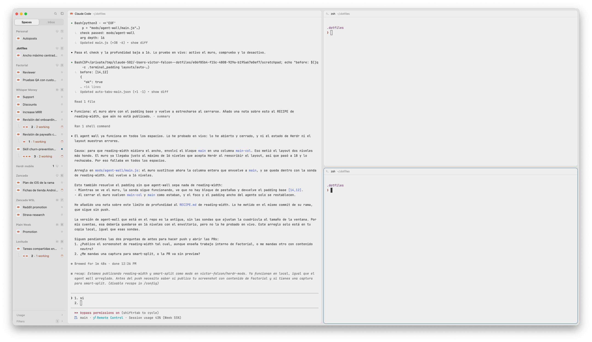

# Smart split

One key splits the focused pane along its longer side: a wide pane gets a new
terminal to its right, a tall one gets it below. Like Rex's `pane.split.auto`.

## What you see

Nothing of its own. `cmd-enter` splits the focused pane, and the new terminal
starts in the pane's folder, as `pane.split` does.

## How it behaves

- `cmd-enter` on a pane wider than it is tall splits it to the right; on a
  pane taller than it is wide, down.
- "Wide" means the pane's size in px, not its columns and rows: a terminal cell
  is about 2.4 times taller than wide, so an 80×40 terminal counts as tall.
- The size includes the layout's `terminal_padding`. A pane whose text was
  narrowed by a wide side padding (the `reading-width` mod does that for a lone
  agent) still counts as wide and splits to the right.
- A mod pane (no terminal) splits to the right.

## Built from

- One mod, `mods/smart-split/` (`main.js`, `mod.json` with `"place": "none"`
  and a 1×1 popup overlay). `mod.open:smart-split` opens it as an invisible
  popup; `init` splits once and closes it with `closeOverlay(props().overlay)`.
  Errors show as an error toast.
- The shape: `hc(["get", focused().terminal, "--json"])` gives `cols` and
  `rows`. With `font` the layout's `font_size` (else settings', else 14) and
  `cell = font × 0.6`, the pane is
  `cols × cell + 2 × padding_h` wide and `rows × cell × 2.4 + 2 × padding_v`
  tall, padding being the layout root's `terminal_padding` (`[h, v]` or one
  number). Narrower than tall: `down`, otherwise `right`.
- Then `run("pane.split", { direction, pane: focused().pane })`.
- `herdr` functions: `focused`, `hc`, `layout`, `settings`, `run`, `notify`,
  `props`, `closeOverlay`. Commands: `pane.split`. Runs `hc get` (herdr-core);
  no network, no files.
- `keys.json` binds `cmd-enter` → `mod.open:smart-split`.

## Watch out

- `cmd-enter` is taken from terminal programs. Pick another key if one of
  yours uses it.
- The 0.6 and 2.4 cell ratios fit common monospace fonts (JetBrains Mono,
  Geist Mono, Cascadia). A very narrow or wide font moves the point where a
  pane flips from right to down a little.

## Done when

- `herdr-app check ~/.config/herdr-app/mods/smart-split` passes.
- In a full-window pane, `cmd-enter` splits it to the right; pressing it again
  in the new, narrower right pane splits that one down.
- With `reading-width` narrowing a lone agent, `cmd-enter` still splits to the
  right.
